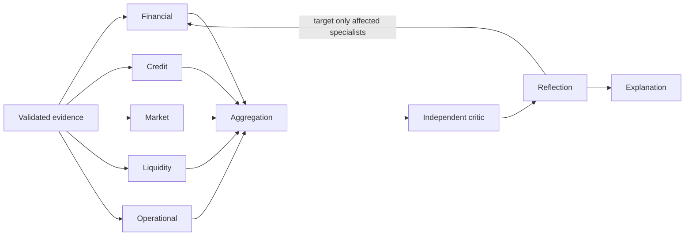

# Agent contracts and responsibilities

Agents are software specialists with explicit data contracts, not actors pretending that deterministic outputs came from a model. The default provider is `deterministic` and reports zero LLM tokens and cost.

Each specialist now supports independent provider-backed interpretation with its own role prompt and optional model override. LLM outputs are separate typed interpretations over canonical Python evidence; bounded read-only metric calls and reference checks cannot mutate the quantitative output. Failures retain calculations with an explicit warning. See [LLM specialists](llm_specialists.md) for configuration, contracts and semantic-validation limits.

| Stage | Responsibility | Output |
|---|---|---|
| Financial analyst | Statement ratios, period comparisons, financial pressure | Metrics, score, findings, limitations |
| Credit analyst | Leverage, debt service, coverage, gated Altman Z | Distress indicators; no uncalibrated PD |
| Market analyst | Volatility, VaR/CVaR, drawdown, beta/correlation, HHI | Historical metrics and sample limitations |
| Liquidity analyst | Working capital, current/quick/cash/OCF ratios, cash contraction | Funding-pressure indicators |
| Operational analyst | Structured supplied qualitative indicators | Evidence-linked severity mapping; no invented incidents |
| Aggregation | Fixed-weight contributions and missing-dimension bounds | Overall score or interval, coverage |
| Independent critic | Original-source recomputation, provenance, contradictions, excessive confidence | Rule IDs, severity, corrections, correctability |
| Self-reflection | Targeted reanalysis and issue-set comparison | Bounded, inspectable correction history |
| Explanation | Evidence-backed rationale and monitoring actions | Deterministic summary, findings, limitations |

Each specialist has a typed `AgentOutput`: identity, dimension, status, optional bounded score, evidence completeness confidence, metrics, findings, limitations and duration. A failed or incomplete output does not count toward score coverage. Findings carry stable IDs, source references, metric references and source-validation monitoring actions.

Critic independence is procedural: it reads original source inputs and is not asked to agree with analyst text. It shares the financial engine and therefore cannot detect a common formula implementation bug. It does not independently establish that uploaded statements are truthful.

The market specialist now uses synchronized constituent portfolios when supplied, exposing covariance/correlation and volatility contributions; it refuses to use standalone asset prices as a portfolio substitute. The liquidity specialist adds a dated maturity ladder and conditional funding-gap finding. Matrix and maturity details live under `analytics` and are independently recomputed by the critic. Stable constituent/debt evidence IDs are included in the source catalog and specialized model packets. Maturity monitoring does not silently reweight the existing liquidity heuristic.
