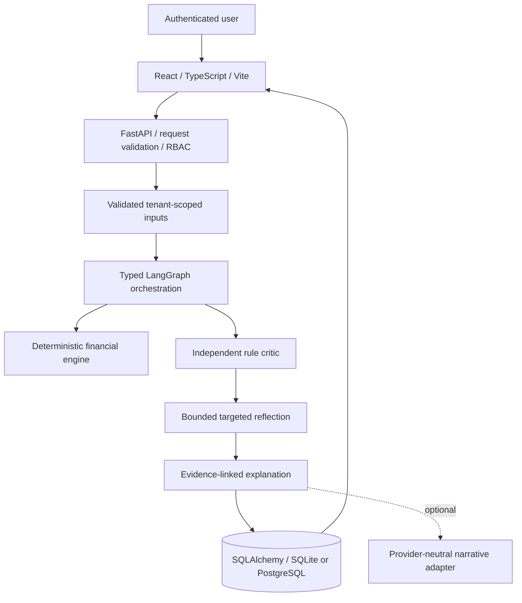
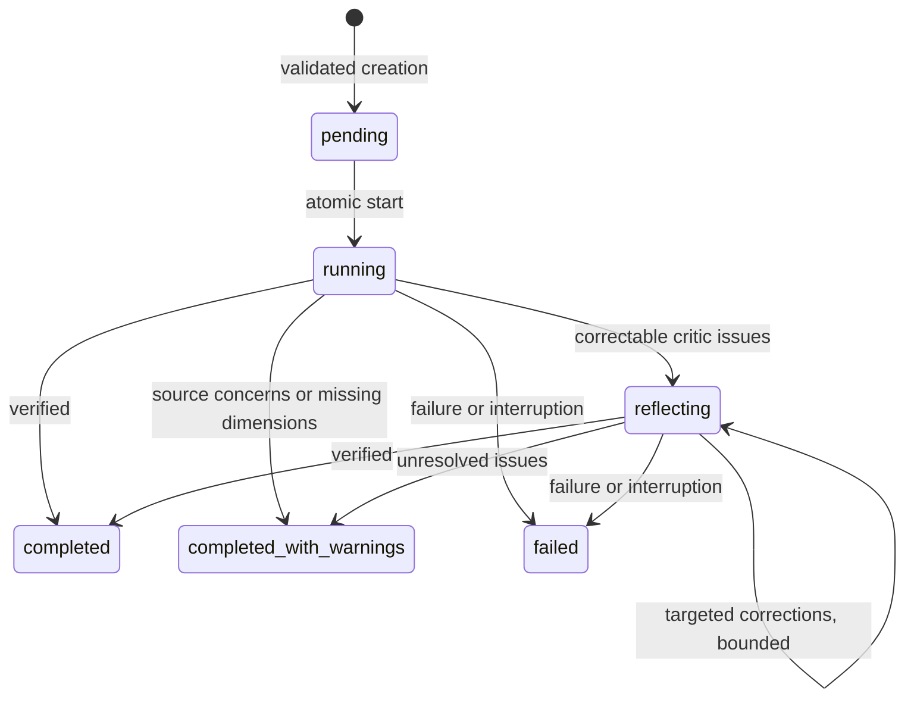

# Architecture

Numeric results come exclusively from Python functions. `Metric` stores value, formula, assumptions, units, evidence references, and limitations. A model provider can only add an explicitly unverified narrative; it cannot change metrics or invoke tools. All required explanation behavior is available deterministically.

Pydantic rejects nonfinite numbers, inconsistent balance sheets, mixed currency, future observations, unsorted or duplicate dates, and invalid weights. Uploads are staged and validated again with provenance when creating an assessment. Inputs and output artifacts persist together with tenant IDs and audit records.

Aggregation also produces a separate overlap/weight/history sensitivity diagnostic. The critic checks component dependencies and recomputes the diagnostic. Explicit exploratory requests operate on saved outputs and are audited without changing canonical scores or calling models. Empirical dependence requires matching historical dimension scores rather than asset-return covariance; insufficient history stays unavailable. Browser account changes clear query caches and selections, and exploratory state is scoped to the selected assessment.

Five independent specialists run concurrently through `asyncio.gather`. Dependent aggregation, critic, reflection and explanation stages execute sequentially in LangGraph. Structured state captures the initial snapshot, executions, issues, correction requests, revised outputs and final verification status. The orchestrator retries failed specialist attempts and applies a per-attempt timeout. Thread timeouts do not forcibly terminate CPU-bound code; see limitations.

Assessment start and durable job enqueue commit together. Polling workers claim expiring database leases and write stage checkpoints through ownership-fenced transactions. API startup leaves live work untouched; expired work resumes at its saved next graph node, preserving reflection history. A standalone worker supports separation from API processes. See [durable jobs](durable_jobs.md) for application-managed checkpoint semantics, in-flight replay and the unverified PostgreSQL scaling boundary.

