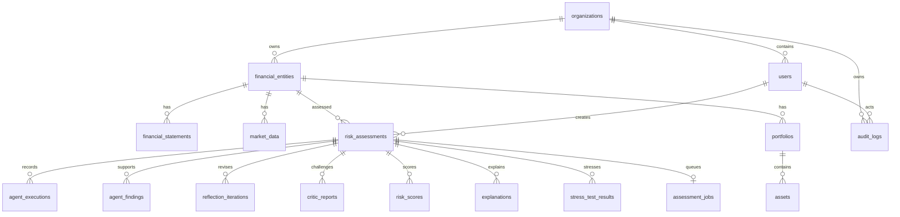

# Database schema

SQLAlchemy models support SQLite locally and PostgreSQL via psycopg. Alembic revision `0001` creates 17 requested tables. Its JSON schema snapshot is frozen independently of live application model definitions. Tables have typed IDs, foreign keys, tenant indexes, artifact assessment indexes, unique user email, and a unique assessment/iteration pair. Run `python -m alembic upgrade head` from `backend`.

Revision `0002` adds `assessment_jobs` (18 tables total) with a unique assessment FK, queue/lease indexes, attempt budget, lease token/expiry, heartbeat, versioned JSON checkpoint and runtime manifest. It adopts pre-migration running/reflecting assessments into the queue for a fresh run; completed and unstarted assessments remain unchanged. Worker ownership is internal and resolved through the tenant-scoped assessment at API boundaries.

`risk_assessments` records entity, organization, creator, type, lifecycle status, score, category, rule version, source JSON, final result JSON and timestamps. Inputs are kept for reproducibility; this creates potentially sensitive data retention obligations.

Financial engine v2 stores constituent histories/provenance and debt schedules in validated assessment input JSON. Portfolio records retain actual holding symbols/weights, histories and optional value; `assets` uses the supplied symbols. Matrix/maturity analytics are included in execution/result/checkpoint JSON, and projected statements are confined to stress-result artifacts, never ingested as historical statements. These extensions require no additional SQL tables.

Sensitivity v1 adds typed score-component metadata to execution outputs, optional comparable score history to assessment input JSON, and the saved diagnostic to checkpoint/result/risk-score artifact JSON. Exploratory diagnostic audit entries record weights/steps and summary, while the original score and report remain immutable. No schema migration is needed; workflow version 4 rejects incompatible queued runtime manifests.

Artifact tables store structured JSON payloads and common timestamps. `agent_executions` additionally stores agent name, execution status, seconds, error and attempts in its payload; `reflection_iterations` stores an indexed iteration number and full before/after state. Critic, finding, score, explanation and stress artifacts are persisted in the completion transaction, fenced by the job lease. Execution-level audit events are durable at completion; they are not streamed live. Job claims, requeues and stage checkpoints have their own committed audit events.

Audit rows contain organization, actor, action, resource type/ID, timestamp and metadata JSON. They are application append-only, but not cryptographically tamper-evident or immutable to a database administrator. Tenant authorization is enforced by API queries and parent ownership; PostgreSQL row-level security is not yet configured.
