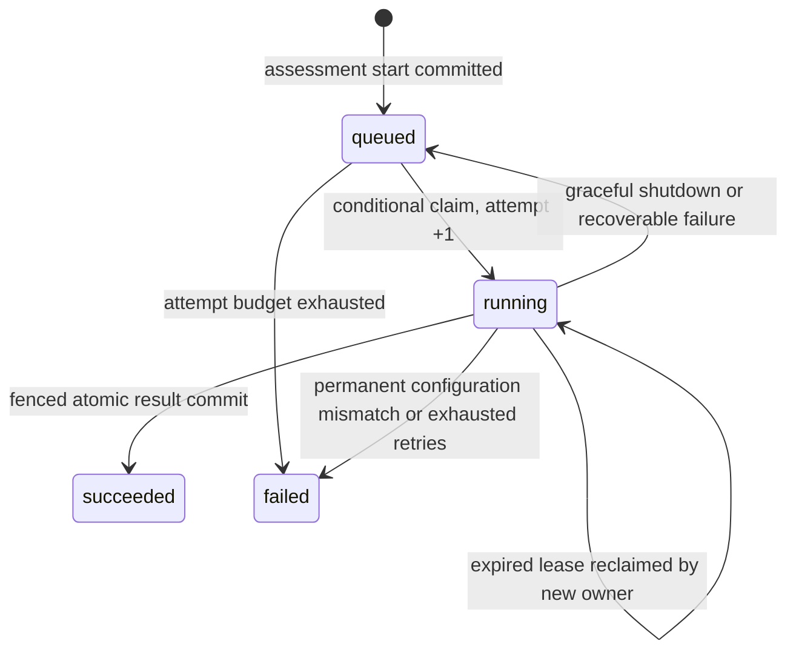

# Durable jobs and recovery

An assessment start now commits a unique `assessment_jobs` entry in the same transaction as the pending→running transition and audit event. Polling workers claim jobs through a conditional SQL update. Starting another API instance no longer fails or reassigns live jobs.

## Ownership and progress

Jobs store queue state, attempt count/budget, available time, lease expiry, heartbeat, ownership token, runtime manifest and a versioned JSON workflow checkpoint. Lease comparisons use the database's clock. A worker renews its lease every one-third of `JOB_LEASE_SECONDS`. A new owner can claim queued work or an expired lease; a live lease cannot be stolen. Attempts increment only when claiming.

Every checkpoint and completion requires the current token and a nonexpired lease in the same SQL transaction as its write. Finalization also atomically saves assessment results, agent artifacts and completion audit. A stale process cannot commit a checkpoint, release another worker's job or produce duplicate final artifacts after reclamation.



## Stage checkpoints

The LangGraph workflow invokes an application-owned persistence callback after each completed node. The checkpoint contains schema version 1, the next node, accumulated active processing seconds and JSON state. It retains specialist outputs, stage executions, initial assessment, issues, correction iterations and explanation when present. Input data stays in the assessment row and is revalidated on resume. Rehydration reconstructs only explicitly declared Pydantic models; no pickle, callable, dynamic import or model-supplied tool is loaded from a checkpoint.

Supported boundaries: specialists→aggregate→critic→reflect→correct/explain, correction→aggregate, and explain→done. The graph reenters at the saved next node. A `done` checkpoint can finalize results after a crash without invoking the graph or model again. Reflection counts and prior corrections survive recovery.

These are **application-managed stage checkpoints**, not LangGraph's native checkpointer/time-travel API. The five parallel specialists currently form one graph node: a crash before that node's checkpoint can replay its in-flight work, including specialists that returned before the crash. Completed checkpointed stages are not replayed. Model requests are therefore at-least-once across crashes, not exactly-once; a provider may bill a repeated in-flight request. Token reporting covers saved execution records and cannot account precisely for a response lost before persistence.

The runtime manifest captures workflow version, specialist/narrative provider and models, model overrides, tool budget, retry count, endpoint hash and role-prompt hashes. Secrets and endpoint credentials are excluded. A mismatch at claim processing, checkpoint or final commit fails explicitly rather than mixing configurations. Administrator prompt/model changes should drain existing jobs or be deployed as a separately versioned worker pool. Unsupported checkpoint versions fail within the retry budget; there is no automatic cross-version conversion.

## Running workers

Default local mode starts one poller in each API process (`WORKER_ENABLED=true`). A standalone worker is also supported:

```powershell
# API terminal, from backend:
$env:WORKER_ENABLED='false'
python -m uvicorn app.main:app --host 127.0.0.1 --port 8000

# Worker terminal, from backend, using the same database and runtime configuration:
python -m app.services.runner
```

Compose now defines a separate `worker` service and disables the API's embedded poller. Multiple workers can compete safely for job ownership by design and have been tested concurrently on SQLite; production PostgreSQL contention, load and failover testing are still outstanding. Migrations must run once before workers start. Do not deploy a mixture of old in-process workers and the new queue workers.

Graceful shutdown cancels in-flight orchestration, requeues an owned job and preserves its checkpoint. Hard termination leaves the lease to expire. Once `JOB_MAX_ATTEMPTS` is exhausted, the assessment becomes failed and remains auditable. A new assessment is required for an operator-requested retry after terminal failure; there is no unrestricted retry endpoint.

`GET /api/v1/assessments/{id}/job` returns organization-authorized queue state, attempts, saved next stage, heartbeat and sanitized last error. It never returns the ownership token or raw checkpoint. Queue claiming is internal and not exposed as a public API.

Observed tests include four competing claim threads, stale-token rejection for heartbeat/checkpoint/finalization/release, a subprocess exiting with `os._exit(73)` after a committed checkpoint, recovery in a fresh process without repeating specialists, API restart with queued work, every graph boundary during reflection, runtime mismatch rejection, graceful shutdown and done-checkpoint finalization with exactly one set of artifacts.
