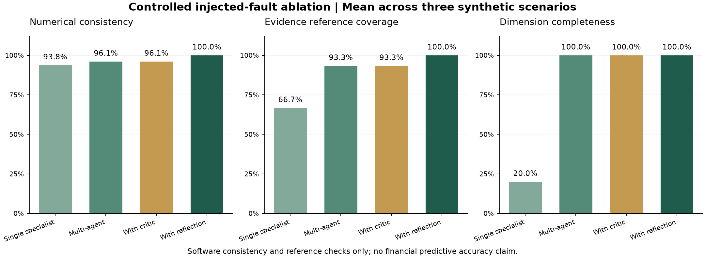

# Controlled ablation methodology

Run `python -m app.evaluation` from `backend`. Results are saved to `data/evaluation/results.json`; the file includes experiment configuration, per-case metrics, detected rule violations, resolved IDs and actual correction counts.

Configurations: A single financial specialist; B five specialists with no critic; C five specialists plus critic; D five specialists plus critic and bounded targeted reflection. For each of three fixed-seed synthetic scenarios run a clean case and a controlled fault-injected case: 24 experiments total. All configurations use the same source bundles and financial engine. The single-specialist baseline intentionally cannot establish a complete multidimensional score and does not silently reweight financial risk to 100%.

Injected faults change the financial current ratio to 999, replace one finding's evidence with an absent source ID, and (when present) change the market score to 99. The liquidity agent's unchanged ratio provides a contradictory finding. Normal user workflows do not insert these faults.

Metrics:

- Numerical consistency: exact equality of stored metrics and scores to canonical recomputation, divided by comparisons. This measures implementation consistency, not model validity.
- Evidence coverage / unsupported claim rate: proportion of findings with nonempty valid references / its complement. A valid reference does not prove that narrative meaning is entailed by a source.
- Contradiction detection: whether the deliberately conflicting shared ratio was detected. Clean cases have no known contradiction and should not be interpreted as false negatives.
- Issue resolution: resolved correctable issue IDs / initial correctable issue IDs; null when no correctable issue exists. Source limitations are not counted as repairable errors.
- Classification consistency: category agreement with the clean five-specialist rule engine; null if no overall score exists. This is not external ground truth.
- Completeness: completed dimensions / 5. Processing time is measured with `perf_counter`, is not deterministic, and is not a representative production load benchmark.
- LLM tokens and cost: zero for these deterministic experiments. Real-provider cost is null until pricing is configured; token usage is recorded when provided by the adapter.

Observed controlled result: all three injected-fault reflection cases resolve their correctable issues in one cycle, restoring numerical consistency and evidence reference coverage. This demonstrates the implemented correction mechanism only. Clean cases need no corrective cycle. The critic and analysts share calculation code, so these experiments cannot expose shared formula bugs.

No empirical claim is made that reflection improves credit prediction, investment performance, fraud detection accuracy or generalized financial accuracy. Real evidence datasets, calibrated labels, external validation, independent numerical implementations, adversarial semantic claims, model/provider comparisons, repeated runs and statistical analysis remain required. SHAP is not presented because there is no deployed calibrated predictive model; it would not explain an LLM's internal reasoning.

Run `python scripts/plot_evaluation.py` from the repository root to regenerate the comparison figure from saved observed metrics (requires optional Matplotlib). The figure compares mean numerical consistency, evidence reference coverage, and dimension completeness in injected-fault cases; it does not substitute for classification ground truth.

