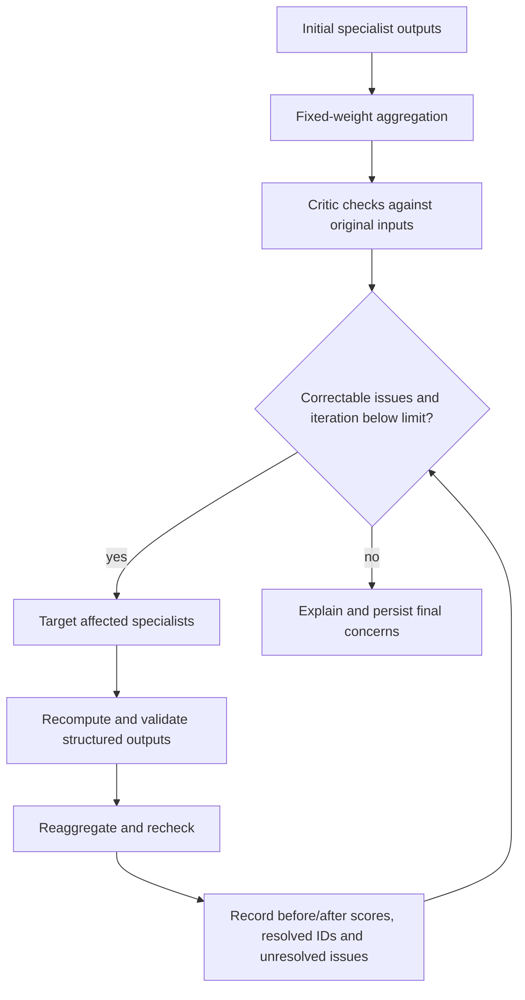

# Measurable reflection

Rules cover missing dimension, score mismatch, metric mismatch, invalid source references, missing formulas, unsupported findings, absent referenced metrics, excessive confidence, shared-ratio contradictions, weight mismatches and unverified sources. Issues have stable IDs, severity, evidence, requested correction and `correctable` status.

Every iteration records detected issues, requested agents, updated assessments, completed corrections (the exact difference between issue-ID sets), unresolved issues, before/after score objects and verification outcome. Resolved means the verifier no longer detects the rule violation; it does not certify real-world truth.

Maximum correction cycles is configurable from 0 to 3. Remaining correctable issues after the cap remain visible. Missing external source data cannot be repaired by asking an agent to invent it. A valid clean analysis can have zero reflection cycles; unverified synthetic provenance remains a warning. Tests inject numeric errors, nonexistent evidence and conflicting shared ratios to demonstrate actual correction behavior without manufacturing errors in normal user assessments.

The final explanation discloses unresolved concerns and evidence classification. A model's self-reported certainty is never a statistical confidence interval. The score interval concerns missing dimensions and is not a probabilistic confidence interval.
